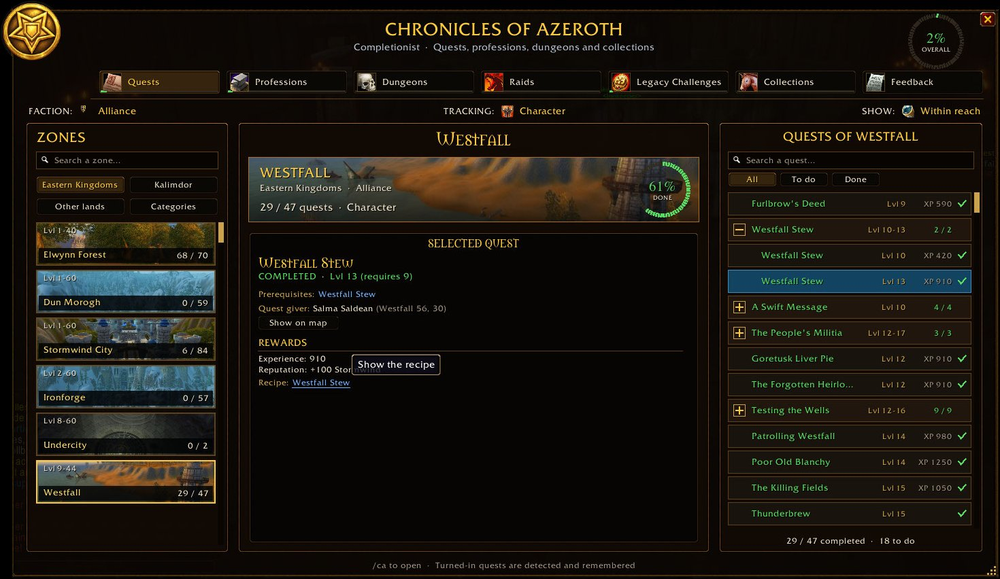
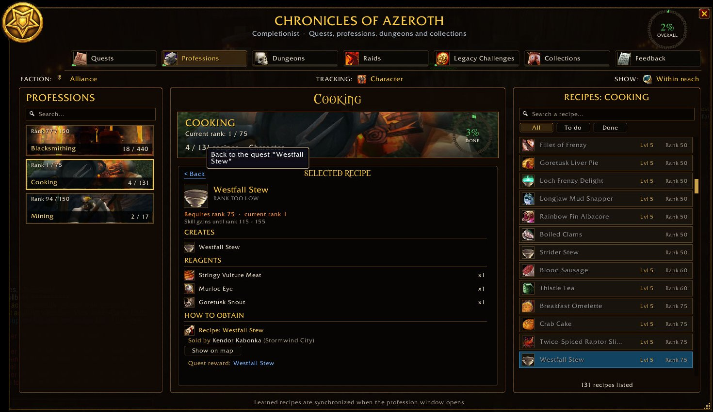
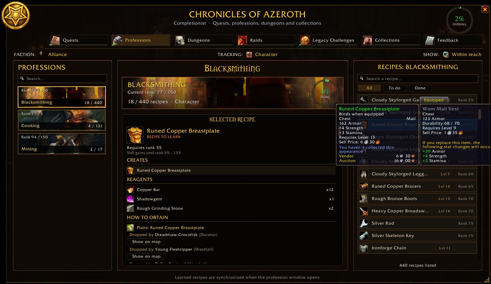
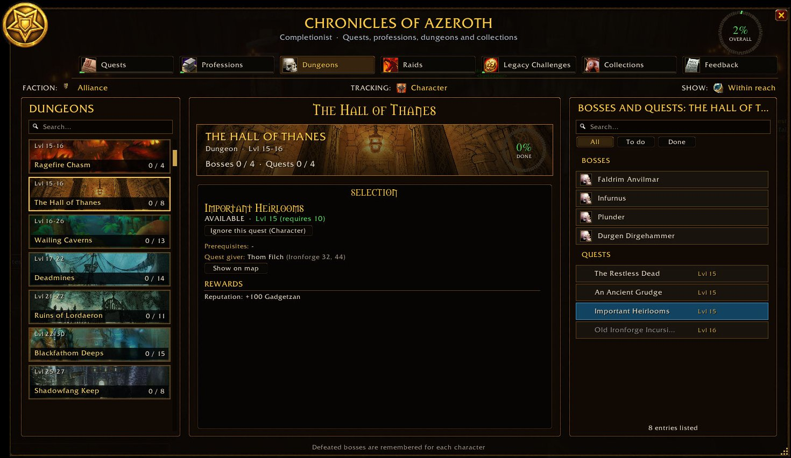
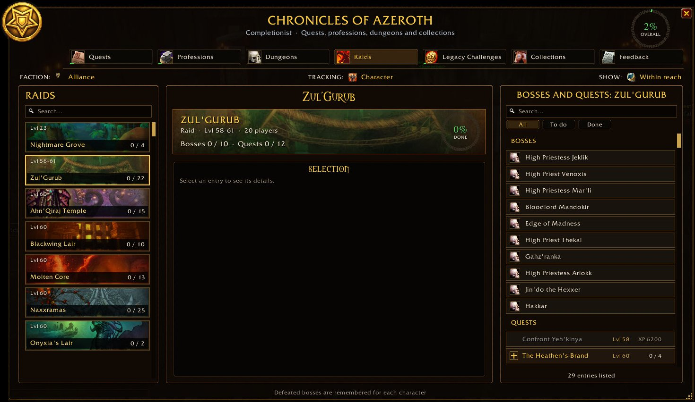
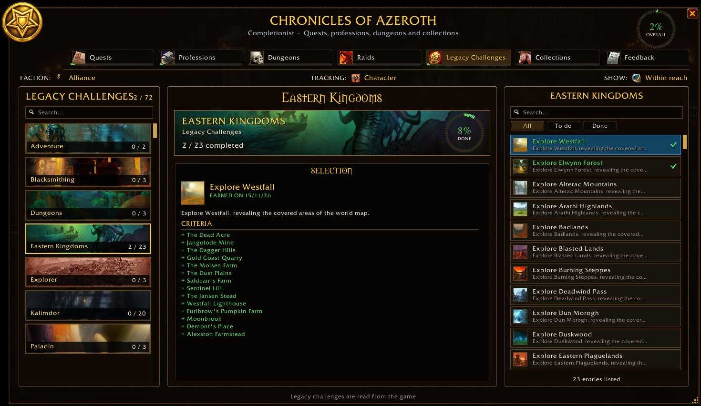
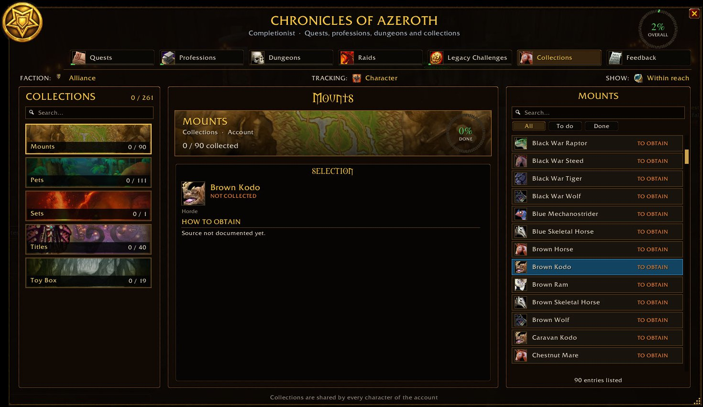

# Chronicles of Azeroth

**Chronicles of Azeroth** is a standalone World of Warcraft Forever addon for tracking quest and profession completion, without requiring Questie, All The Things, or any other addon.

<p align="center">
  <a href="docs/images/quests.jpg"></a>
  <a href="docs/images/professions.jpg"></a>
  <a href="docs/images/recipes.jpg"></a>
  <a href="docs/images/dungeons.jpg"></a>
</p>
<p align="center">
  <a href="docs/images/raids.jpg"></a>
  <a href="docs/images/challenges.jpg"></a>
  <a href="docs/images/collections.jpg"></a>
</p>

## Features

- **Quests**: zones grouped by continent, with their completion; quests grouped into chains
  that unfold; for each quest its status, level, prerequisites, follow-ups, giver and turn-in
  NPC (with a map waypoint), experience and reputation rewards. A quest is shown locked, with
  the reason, while the character's level, its prerequisites or the rank of the profession it
  needs fall short. Every zone and quest category has its artwork, built from screenshots
  of the game.
- **Professions**: the complete catalogue of each profession for the Forever client, the
  recipes already learned, the reagents, and how to obtain each recipe (trainer, vendor,
  drop, quest).
- **Dungeons and raids**: the bosses defeated and the quests of each instance; an instance
  quest opens in its tab, on its instance.
- **Legacy challenges**, read from the game; within reach, the categories of another class
  or of a profession the character has not learned are left out.
- **Collections** (mounts, pets, toys, appearance sets, titles): what is owned and what is
  missing, with the source of each item.
- **Account or character tracking**: the account view merges the progress of every character
  that logged in with the addon enabled; a faction selector shows the other faction's quests.
- **Within reach**: the character view keeps only what the character can do (its race, its
  class and the professions it has learned), with the counts to match; a switch shows
  everything.
- **Ignored quests**: a quest that cannot or need not be done (a Collector's Edition gift, a
  missed event) can be ignored from its details, which takes it out of the counts. The
  account view sets the account's choice; a character follows it unless it made its own.
- **Repeatable quests** (repeatable, daily, weekly) never count in the totals. The server
  does not remember them, so the addon does: one turned in stays done, and one done before
  can be marked done from its details.
- **Links**: a quest links to its prerequisites, follow-ups, exclusive quests and the quest
  it leads to, to the profession it asks for and to the recipes it rewards; a recipe links
  to the quests that reward it. A Back link returns to where the link was followed, step by
  step.
- **Progress gauges**: a thin bar under each tab shows its progress, with its figures in the
  tooltip, and the ring at the top right the overall progress, the mean of the tabs, so that
  each tab weighs the same whatever its number of entries.
- **One layout for every tab**: the groups on the left, the selected group and item in the
  middle, the items of the group on the right, with the same search and the same filter
  (all, to do, done) on every list.
- **Feedback**: a tab prepares a diagnostic report to copy into a GitHub issue or the
  Discord; nothing is sent automatically.
- French and English, with every text about game content read from the client in its own
  language.

## Install

1. Download a [release archive](https://github.com/Rincevant/chronicles-of-azeroth/releases).
2. Extract the `ChroniquesAzeroth` folder into the World of Warcraft `Interface/AddOns` directory.
3. Enable **Chronicles of Azeroth** from the character-selection AddOns menu.
4. Type `/chroniques` in game, or use the minimap button or the addon compartment.

| Command | Effect |
| --- | --- |
| `/chroniques` or `/ca` | open or close the window |
| `/ca help` | list the commands |
| `/ca diag` | list which game features the client provides |
| `/ca log [count]` | print the last log entries |
| `/ca debug` | toggle detailed logging |
| `/ca rescan` | read the character's progress again |
| `/ca scale <0.5-2>` | scale the whole window |
| `/ca minimap` | show or hide the minimap button |
| `/ca reset` | clear the cache of game texts |
| `/ca clearlog` | clear the log |

The minimap button opens the window with a left click and switches between **Account** and
**Character** tracking with a right click; drag it around the minimap to move it. Drag the
header of the window to move it and the grip in its bottom right corner to resize it; both
are kept between sessions.

The addon keeps a log in its saved variables, written by the game on `/reload` and on logout:
`WTF/Account/<account>/SavedVariables/ChroniquesAzeroth.lua`, table `ChroniquesAzerothDB.log`.
At every login it records which client APIs exist, and any error of the addon is written there
instead of interrupting the game, which helps when a feature behaves differently on the
Forever client.

The saved variables of the versions before 1.0 are converted at the first login: each
character keeps the quests and recipes it had recorded, and the tracking mode and the place
of the minimap button carry over.

## Repository layout

- `ChroniquesAzeroth/` — addon source files: `Core/` (lifecycle, log, client API wrappers,
  saved variables, player, names), `Locales/`, `Data/` (generated), `Modules/` (the progress
  of each domain), `UI/` (the window, the shared widgets and one view per tab) and `Assets/`
  (the artwork of the zones and the medallion).
- `tools/` — the data generator, the artwork importer and the version check. They are not
  needed at runtime.
- `tests/` — offline tests, run on top of an emulation of the WoW API.
- `docs/images/` — the screenshots of this README.
- `.github/workflows/` — continuous integration and release publication.

## Development

The tests load the addon in TOC order on top of an emulation of the WoW client API
(`tests/wow_stub.lua`), log in, open the window and go through every tab and list. The run
fails on any error the addon logs, on any missing translation and on any failed check. They need a Lua 5.1 interpreter (or
LuaJIT):

```sh
lua5.1 tests/run.lua
CA_TEST_LOCALE=frFR lua5.1 tests/run.lua
```

Every push and pull request runs them on GitHub Actions, together with a compilation of
every Lua file and a read of the version of the TOC.

The files of `ChroniquesAzeroth/Data/` are generated by `tools/build_data.py` from these
sources, which are only read at build time: in game, the addon reads no other addon and
makes no network access.

- [QuestieDB](https://github.com/Questie/QuestieDB) (GPL-3.0): the quest structure (zones,
  levels, prerequisites, quest givers) and the sources of recipe items. Only identifiers and
  numbers are kept, plus the quest titles of its translations and English names, used when
  the client cannot provide a text.
- The client tables of the targeted WoW Forever build, as published by
  [wago.tools](https://wago.tools): recipes, instances, encounters, collectible identifiers,
  the loading screens of the instances and the few localized strings the client API does not
  expose.
- [Wowhead Forever](https://www.wowhead.com/forever): the localized quest titles QuestieDB
  lacks, read from its quest tooltips one request every 10 to 15 seconds, and the rank a
  recipe is learned at when no client table gives it. The profession pages answer browsers
  only: `--wowhead-browser http://localhost:9222` reads them through a Chromium browser of
  your own started with `--remote-debugging-port=9222`.

```sh
python -I tools/build_data.py --build 1.60.1.70888
python -I tools/build_data.py --offline     # from the cache alone, without any download
```

Downloads are cached in `.cache/`, which git ignores; delete it to refresh them.

See [CONTRIBUTING.md](CONTRIBUTING.md) for the conventions of the repository.

## Releases

A release is published by itself when a new version reaches `main`:

1. Set the new version in `ChroniquesAzeroth/ChroniquesAzeroth.toc` (`## Version:`); the
   addon reads it from there.
2. Add its section to [CHANGELOG.md](CHANGELOG.md), headed `## <version>`.
3. Merge or push the change to `main`.

On every push to `main`, the release workflow reads the version of the TOC. When no tag
`v<version>` exists yet, it runs the tests, packages the `ChroniquesAzeroth` folder with the
license into `ChroniquesAzeroth-v<version>.zip`, creates the tag and publishes the zip as a
GitHub release whose notes are the version's section of the changelog; it stops if that
section is missing. A push that keeps the version publishes nothing, and a version with a
suffix, such as `-beta`, is published as a pre-release. The workflow can also be started by
hand from the Actions tab.

## Feedback

Use the **Feedback** tab in game to prepare a diagnostic report, then copy it with `Ctrl+C`.

- For bugs and feature requests, [open a GitHub issue](https://github.com/Rincevant/chronicles-of-azeroth/issues).
- For quick discussion and community support, join the [Chronicles of Azeroth Discord](https://discord.gg/hmQTKkdRzB).

## License

GPL-3.0-or-later, see [LICENSE](LICENSE). The quest data derived from QuestieDB is GPL-3.0
as well.
